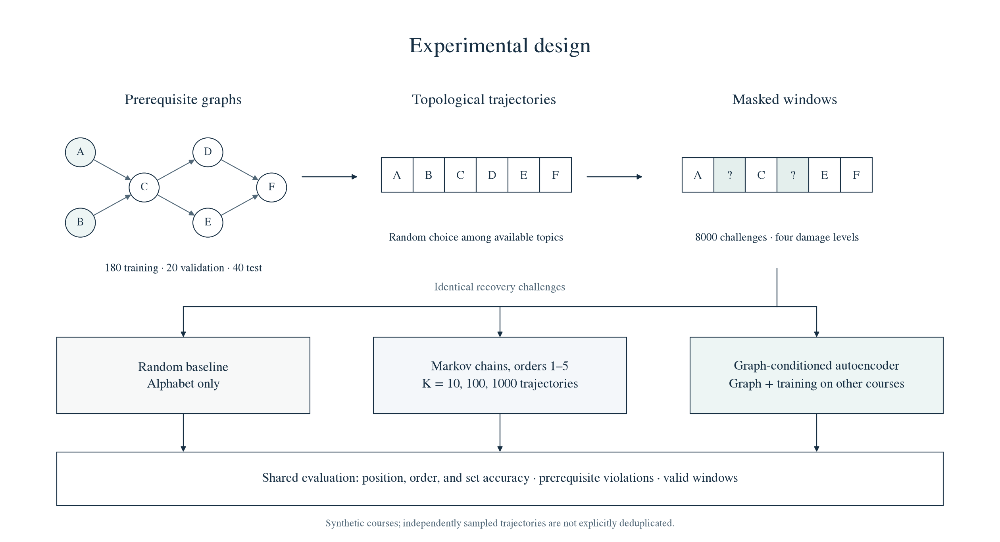
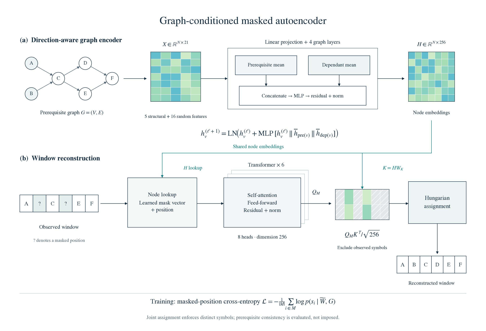
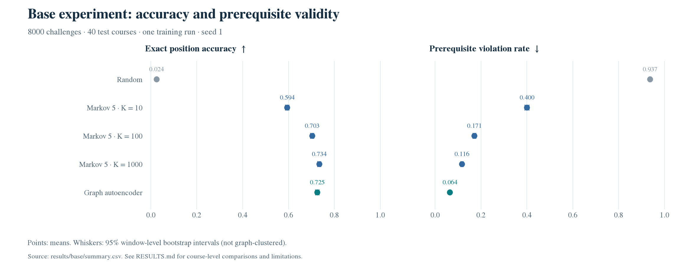

# Graph-conditioned reconstruction of learning trajectories

[](https://zenodo.org/badge/latestdoi/871597842)
[](https://github.com/sergeykhomenko/sequence-recovery/actions/workflows/ci.yml)
[](LICENSE)

Research software for studying the reconstruction of missing fragments in
learning trajectories. A course is represented by a **predicate alphabet**
and a directed acyclic graph of prerequisite relations. The experiment masks
fragments of valid trajectories, reconstructs their missing symbols, and
measures both recovery accuracy and consistency with prerequisites.

The research question is whether a model that knows the course structure can
recover trajectories of previously unseen courses without observing their
historical trajectories. We compare a random baseline, Markov chains with
limited course history, and a graph-conditioned masked autoencoder.

## Experimental framework



| Method | Information available about a test course |
|---|---|
| Random | Alphabet only |
| Markov, orders 1–5 | 10, 100, or 1000 sampled trajectories; no prerequisite graph |
| Graph autoencoder | Prerequisite graph; trained on other courses, without this course's trajectories |

Every method fills the same masks, preserves observed symbols, and uses each
symbol at most once. Independently sampled test trajectories are not
explicitly deduplicated against Markov training trajectories.

[Full protocol and metrics →](docs/experiment.md)

## Model architecture



The graph encoder aggregates incoming prerequisites and outgoing dependants
separately. A transformer encodes the masked window, and a joint assignment
selects distinct symbols for the missing positions.

[Architecture details →](docs/architecture.md) · [Vector figure →](docs/figures/autoencoder-architecture.svg)

## Quick start

Requirements: **Go ≥ 1.24**, **uv**, **Make**, and Git on Linux, macOS, or WSL.
[Install Go](https://go.dev/doc/install) and
[uv](https://docs.astral.sh/uv/getting-started/installation/).
uv manages Python 3.13 and the locked dependencies. The first run downloads
packages; no API key, external model service, or system Graphviz is required.

```bash
git clone https://github.com/sergeykhomenko/sequence-recovery.git
cd sequence-recovery
make test
make smoke DEVICE=cpu
```

The smoke run executes the full pipeline on a small configuration and writes
the model, predictions, and three evaluation reports to `out/smoke/`.

```bash
make pipeline EXP=base     # full research experiment
make verify-results       # check the archived scores and summaries
make analysis             # repeat the course-level statistical analysis
make figures              # rebuild the PNG and SVG figures
```

The full experiment trains for 30,000 steps and needs substantially more time
and memory than the smoke test. `DEVICE=auto` selects CUDA, MPS, or CPU.

[Reproduction, resources, and resume →](docs/reproduction.md) ·
[Configuration →](docs/configuration.md)

## Results



In the recorded run, the autoencoder achieved **0.725 exact position accuracy**
and **0.064 prerequisite violation rate** without training on trajectories of
the test courses. The order-5 Markov model with 1000 trajectories achieved
0.734 and 0.116, respectively. Course-level analysis supports the difference
in violations; positional accuracy is comparable at that history budget.

These results describe one training run on synthetic courses. The methods
receive different information, and transfer to real student data was not
measured. The complete comparison includes confidence intervals, course-level
checks, and limitations. Compressed per-window scores and the original reports
are also available.

[Full results →](RESULTS.md) · [Archived scores and reports →](results/base/README.md)

## Repository structure

| Path | Purpose |
|---|---|
| `cmd/`, `internal/` | Go generation, Markov models, recovery, evaluation, and tests |
| `autoencoder/` | PyTorch model, training, inference, tests, and dependency lock |
| `experiments/` | Base and smoke configurations |
| `scripts/` | Reproducible figures, report verification, and statistical reanalysis |
| `results/base/` | Recorded experimental scores, reports, and training log |
| `docs/` | Protocol, architecture, reproduction, and figures |

Run `make check` for formatting and static checks. GitHub Actions also runs
unit tests, validates citation metadata, verifies the archived reports, and
executes the smoke experiment.

[Contribution guide →](CONTRIBUTING.md)

## Citation

Please cite the **version-specific Zenodo DOI** of the software release used
in your work. The DOI badge links to the archived release, where formatted
citations and BibTeX are available. Machine-readable author and software
metadata are provided in [CITATION.cff](CITATION.cff).

**Serhii Khomenko** · [ORCID 0000-0001-7185-9101](https://orcid.org/0000-0001-7185-9101)<br>
Kharkiv National University of Radio Electronics

## License

[MIT](LICENSE). Copyright © 2026 Serhii Khomenko.
