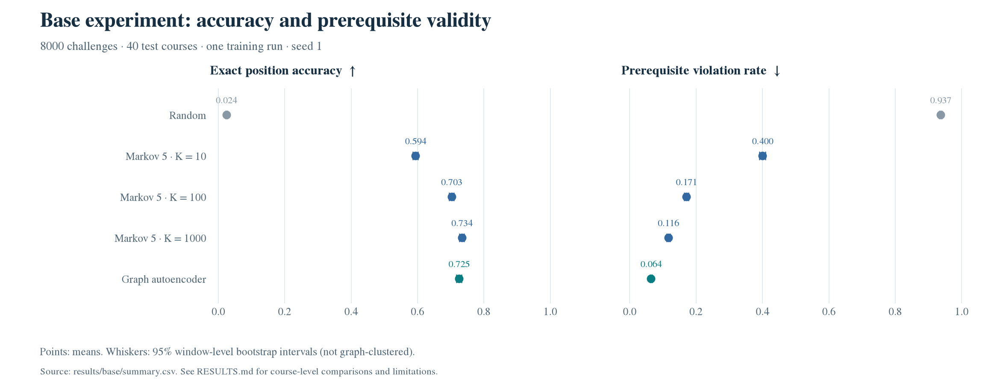

# Experimental results

[README](README.md) · [Experiment design](docs/experiment.md)

These are the results of the base experiment ([base configuration](experiments/base.json), seed 1):

- 40 test graphs of 16–4096 symbols, none of which the autoencoder saw in training;
- 8000 challenges;
- the autoencoder trained for 30 000 steps on an Apple M5 Pro (MPS, about 3 hours),
  with validation EPA levelling off at 0.60;
- a single training run.

The table shows means with 95 % bootstrap intervals from the [archived summary](results/base/summary.csv).
Intervals that are not shown are within ±0.011.

| Method | Trajectories of the test course | EPA | OAR | UAR | PVR ↓ | VWR |
|---|---|---|---|---|---|---|
| random | — | 0.024 [0.022, 0.027] | 0.071 | 0.109 | 0.937 [0.933, 0.941] | 0.020 |
| markov-5-k10 | 10 | 0.594 [0.586, 0.602] | 0.712 | 0.785 | 0.400 [0.391, 0.409] | 0.456 |
| markov-5-k100 | 100 | 0.703 [0.695, 0.710] | 0.820 | 0.909 | 0.171 [0.164, 0.178] | 0.701 |
| markov-5-k1000 | 1000 | 0.734 [0.726, 0.741] | 0.846 | 0.932 | 0.116 [0.111, 0.122] | 0.775 |
| ae | 0 | 0.725 [0.718, 0.732] | 0.841 | 0.943 | 0.064 [0.061, 0.068] | 0.725 |

Order 5 has the highest overall EPA among the tested Markov orders at every
budget. All orders are included in the archived summary.

Paired Wilcoxon signed-rank tests of `ae` against Markov, from the [archived comparisons](results/base/comparisons.csv).
The table gives the effect size r. Positive r means the autoencoder is higher,
which is better for EPA, OAR and UAR. For PVR, negative r means the autoencoder
makes fewer violations. Holm-adjusted p < 10⁻⁶ everywhere except the two cells
marked *, where p = 0.002 (EPA) and p = 0.001 (OAR).

| `ae` vs | EPA | OAR | UAR | PVR |
|---|---|---|---|---|
| markov-5-k10 | +0.49 | +0.62 | +0.79 | −0.81 |
| markov-5-k100 | +0.11 | +0.15 | +0.51 | −0.55 |
| markov-5-k1000 | −0.05* | −0.06* | +0.29 | −0.31 |

EPA / PVR by damage level:

| Level | ae | markov-5-k10 | markov-5-k100 | markov-5-k1000 |
|---|---|---|---|---|
| easy | 0.782 / 0.039 | 0.634 / 0.223 | 0.752 / 0.061 | 0.783 / 0.031 |
| medium | 0.810 / 0.045 | 0.657 / 0.268 | 0.789 / 0.070 | 0.822 / 0.035 |
| hard | 0.741 / 0.063 | 0.610 / 0.468 | 0.720 / 0.156 | 0.754 / 0.087 |
| extreme | 0.567 / 0.111 | 0.476 / 0.641 | 0.550 / 0.396 | 0.575 / 0.313 |

Findings:

- **Against Markov with 10 and 100 trajectories.** The autoencoder was not trained on
  trajectories of the test course and has better window-level averages than
  Markov trained on 10 or 100 of them on all five metrics. The course-level
  VWR difference at K = 100 is not significant after correction.
- **Against Markov with 1000 trajectories.** Positional accuracy is on par
  (EPA 0.725 against 0.734, r = −0.05). The autoencoder has a 45 % lower mean rate of
  prerequisite violations (PVR 0.064 against 0.116) and recovers the missing
  set of symbols slightly better (UAR 0.943 against 0.932).
- **The gap in violations grows with damage.** At the extreme level PVR is 0.11
  for the autoencoder, against 0.31 for Markov with K = 1000 and 0.64 with K = 10.
- **Where Markov with 1000 trajectories keeps the lead.**
  - It leaves more windows without any violation: VWR 0.775 against 0.725. The
    autoencoder makes fewer violations, but they are spread over more windows.
  - It is more accurate on the largest graphs: EPA 0.785 against 0.729 for
    2048–4095 symbols.

Limitations:

- **One training run.** It was on a GPU whose kernels are not deterministic, so
  repeated runs differ slightly; several seeds would give variance estimates.
- **Predictable trajectories.** With `decay` 0.7–0.9, few topics are open at
  each step, so trajectories of the base configuration are fairly
  predictable. Wider settings were not measured for the autoencoder.

`make pipeline EXP=base` reruns the experiment into `out/base/`. It does not
replace the archived reports. Training on other hardware or software may give
different results; the full base experiment was not rerun during publication
preparation.

- **Independent sampling is not deduplication.** Test trajectories are sampled
  separately, but can coincide with stored Markov training trajectories.
- **Windows share graphs.** Confidence intervals and paired tests operate on
  windows, not independent graph-level aggregates. See the
  [statistical interpretation](docs/experiment.md#statistical-interpretation).

The hardware and runtime above are author-reported observations from the
original run. The archived files contain its configuration and training log,
but no complete hardware/software environment manifest.

## Course-level robustness analysis

The manuscript also examines the dependence between windows from the same
course. The following post hoc analysis averages each metric within each of
40 test courses, then compares the 40 paired course scores. It is reproduced by
`scripts/summarize_results.py` directly from the archived window-level scores.

Confidence intervals use 10,000 paired bootstrap resamples of courses with seed
1. Wilcoxon uses SciPy's `method="auto"` (exact when eligible, with its documented
tie/zero handling otherwise). Holm adjustment is applied jointly to all 15
comparisons: three Markov budgets × five metrics. Positive differences mean
higher autoencoder scores; lower PVR is better. Bootstrap endpoints can differ
slightly from the manuscript's independently generated resamples.

| Compared with | Metric | AE − Markov [95% course CI] | Courses: better / worse / tied | Holm-adjusted p |
|---|---|---|---|---|
| markov-5-k10 | EPA | +0.131 [+0.105, +0.157] | 36 / 4 / 0 | < 0.000001 |
| markov-5-k10 | OAR | +0.130 [+0.105, +0.155] | 38 / 2 / 0 | < 0.000001 |
| markov-5-k10 | UAR | +0.158 [+0.132, +0.186] | 40 / 0 / 0 | < 0.000001 |
| markov-5-k10 | PVR | -0.336 [-0.373, -0.298] | 40 / 0 / 0 | < 0.000001 |
| markov-5-k10 | VWR | +0.269 [+0.231, +0.305] | 39 / 1 / 0 | < 0.000001 |
| markov-5-k100 | EPA | +0.022 [+0.007, +0.038] | 29 / 11 / 0 | 0.023267 |
| markov-5-k100 | OAR | +0.021 [+0.010, +0.033] | 30 / 10 / 0 | 0.003831 |
| markov-5-k100 | UAR | +0.034 [+0.025, +0.044] | 39 / 1 / 0 | < 0.000001 |
| markov-5-k100 | PVR | -0.107 [-0.127, -0.086] | 39 / 1 / 0 | < 0.000001 |
| markov-5-k100 | VWR | +0.025 [-0.008, +0.055] | 29 / 11 / 0 | 0.102736 |
| markov-5-k1000 | EPA | -0.009 [-0.020, +0.002] | 20 / 20 / 0 | 0.969042 |
| markov-5-k1000 | OAR | -0.004 [-0.011, +0.003] | 19 / 21 / 0 | 0.969042 |
| markov-5-k1000 | UAR | +0.011 [+0.006, +0.016] | 35 / 5 / 0 | 0.000011 |
| markov-5-k1000 | PVR | -0.052 [-0.066, -0.038] | 35 / 5 / 0 | < 0.000001 |
| markov-5-k1000 | VWR | -0.049 [-0.079, -0.023] | 13 / 25 / 2 | 0.023267 |

Against K = 1000, course-level EPA and OAR differences are not significant
(adjusted p ≈ 0.969). The advantages in UAR and PVR remain, as does the lower
VWR. Against K = 100, EPA, OAR, UAR, and PVR improve; VWR does not show a
significant difference after correction. This separates evidence about whole
courses from the original window-level tests.

## Scope of the evidence

- The prerequisite graph and historical trajectories are different information
  sources; this is not an equal-information comparison.
- A nonlearned graph-aware baseline was not included, so the contribution of
  knowing the graph is not isolated from the contribution of learning.
- Train and test graphs come from the same synthetic generator. Unseen graph
  IDs do not imply transfer to real courses or to another graph distribution.
- Mask positions are known. Deletion without a mask marker, repeated topics,
  and noisy observed symbols are outside the protocol.
- One training seed does not quantify training variability. Window-level
  bootstrap intervals do not account for clustering by graph; the course-level
  analysis above addresses that source of dependence separately.

See [archive provenance](results/base/README.md) and
[reproduction instructions](docs/reproduction.md) for what can be verified
without retraining and what requires a new experiment.
