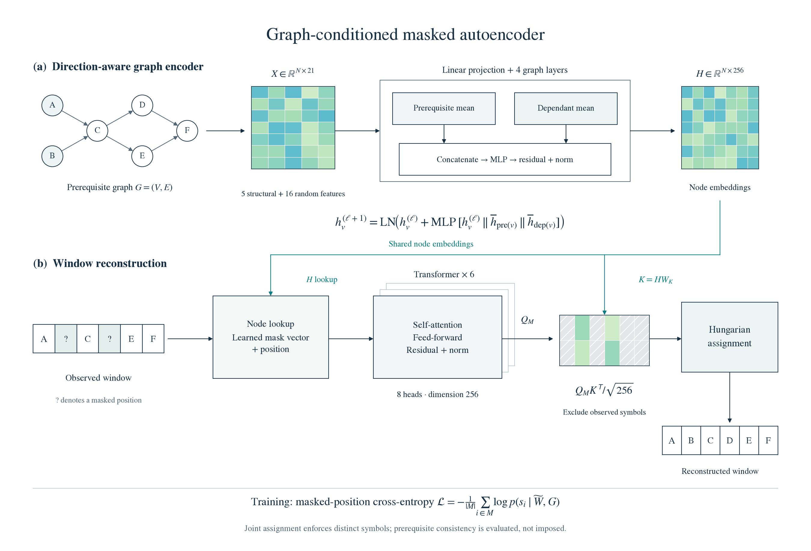

# Model architecture

[README](../README.md) · [Experiment design](experiment.md) · [Results](../RESULTS.md)



[Vector figure](figures/autoencoder-architecture.svg)

## Directional graph aggregation

For each node, five structural features encode log in-degree, log out-degree,
the entry-point indicator, normalized depth, and normalized height. Sixteen
random features are drawn on every graph-encoder call to distinguish nodes
with identical structural descriptors. Symbol names are identifiers, not input
features. The combined features are projected to 256 dimensions.

Each of four message-passing layers calculates two separate means: incoming
prerequisite embeddings and outgoing dependant embeddings. The current node
state and these two means are concatenated, passed through an MLP, added to the
current state, and normalized:

```text
prerequisite_mean(v) = mean of h(u) over edges u → v
dependant_mean(v)    = mean of h(w) over edges v → w
h_next(v)           = LayerNorm(h(v) + MLP([h(v), prerequisite_mean(v), dependant_mean(v)]))
```

An empty neighborhood contributes a zero vector. The MLP uses dimensions
768 → 512 → 256 with GELU activation. Edge direction is preserved by the two
aggregators. See `MessageLayer` and `GraphEncoder` in
[model.py](../autoencoder/graph_ae/model.py).

## Window reconstruction

Kept symbols use their graph embeddings; masks use a learned vector. Learned
positional embeddings are added before a six-layer transformer encoder with
eight attention heads and a feed-forward dimension of 1024. Padding is excluded
from attention. Masked-position queries score all graph nodes against projected
node keys, scaled by the square root of the embedding dimension.

Nodes already present in the window are excluded. At inference, the Hungarian
algorithm jointly assigns distinct symbols to all masks, maximizing their
total log-probability. It enforces uniqueness, but does not impose prerequisite
constraints; violation metrics assess that separately. See
[decode.py](../autoencoder/graph_ae/decode.py).

## Training and model selection

AdamW minimizes cross-entropy over masks, using batches of 64 windows from one
training graph at a time. The base run uses learning rate 0.0003, 1000 warm-up
steps, cosine decay, and 30,000 steps. Validation runs every 1000 steps; the
checkpoint with the highest validation EPA is retained.

Validation EPA uses per-mask argmax, while final inference uses joint
assignment. The validation score is therefore not directly comparable to the
test score. Train/validation graphs and trajectories are disjoint from the
autoencoder's test graph IDs. The graph-aware model and history-based Markov
baseline have different sources of information.

The diagram describes [base.json](../experiments/base.json). The smoke
configuration reduces the dimensions, layers, graph counts, and training steps.
Run `make figures` to rebuild the diagrams and result chart from their source.
